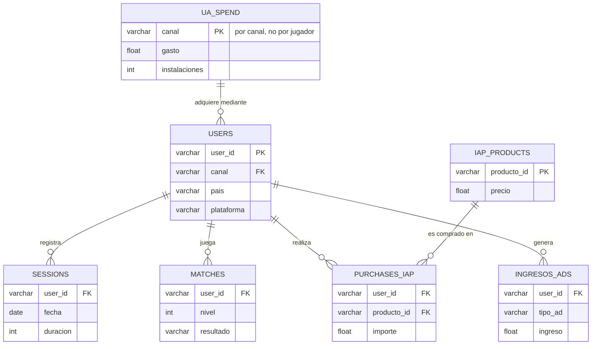

### 📊 PlayLoop Project 

## 💼 Executive Summary 

### 🎯 Key Findings

### 🤝 Business Implication

## 📁 Project structure
```
BrightCart Project/
├── data/                   # Main folder for data
│   ├── raw/                # Original data (immutable, never overwritten)
│   └── processed/          # Clean and final data ready for modeling or visualization
│
├── notebooks/              # Jupyter notebooks
│   └── 
│
├── outputs/                # Generated reports, presentations, or dashboards
│   └── 
│
├── sql/                    # Querys
│   └── 
│
├── .gitignore              # Files and folders that Git should ignore (e.g., /data/raw, .env)
├── README.md               # Main project documentation (objectives, how to run it)
└── requirements.txt        # Python dependencies (pandas, matplotlib, seaborn, etc.)

```
## 🗄️ Data Model (Entity-Relationship)


## 🧰 Tech Stack 
- Analysis: Python, Pandas, PostgreSQL
- Visualization: Matplotlib
- Reporting: Jupyter Notebook
- Version Control: Git / GitHub

## 👤 Autor

Jimmy Ramírez — [LinkedIn](https://www.linkedin.com/in/jimmy-ramirez-g) · [GitHub](https://github.com/jimmyramirezg6-blip)
