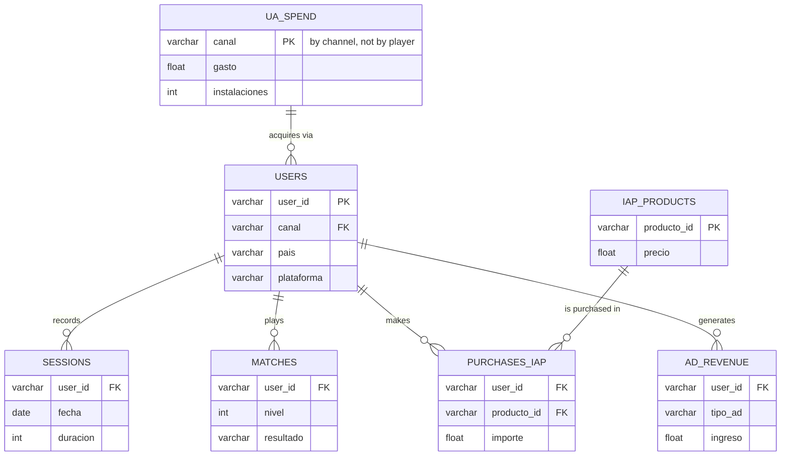

### 📊 PlayLoop Project 

## 💼 Executive Summary 

Analysis of acquisition, retention, and monetization for the game using `users`, `sessions`, `purchases`, `ad_revenue`, and `ua_spend`. The goal was to compare channels and measure whether the value generated per player compensates for acquisition cost.

### 🎯 Key Findings

- `coinrush` starts with a positive signal thanks to its low CPI, but it does not sustain profitability over time.
- Its retention drops from 37.0% on D1 to 2.4% on D7 and 0.8% on D30.
- Its payer conversion is 0.11%, the lowest among the channels analyzed.
- Its ROAS is 0.27, with a net LTV of 0.12 EUR versus a CPI of 0.45 EUR.
- That means that for every 1,000 EUR invested in CoinRush, only 270 EUR are recovered.
- `apple_search`, `meta`, `google`, and `tiktok` stay above break-even with ROAS greater than 1.

### 🤝 Business Implication

The `coinrush` channel does not recover the investment and should be reviewed before scaling budget further. The project shows that investment decisions should not rely on CPI alone, but on retention, conversion, and ROAS by channel.

## 🔗 Project Source

The datasets used in this project are stored in this repository under `data/raw/` and `data/processed/`. The project is based on the case study published at [Playloop](https://bigdatastack.dev/profesion/analisis-datos/mundo-real/playloop).

## 📁 Project structure
```
PlayLoop Project/
├── data/                   # Main folder for data
│   ├── raw/                # Original data (immutable, never overwritten)
│   └── processed/          # Clean and final data ready for modeling or visualization
│
├── notebook/               # Jupyter notebooks
│   ├── 01_initial_exploration.ipynb
│   ├── 02_cleaning.ipynb
│   └── 03_visualizations.ipynb
│
├── outputs/                # Generated reports, presentations, or dashboards
│   ├── retention_by_channel.png
│   ├── payer_conversion_by_channel.png
│   └── roas_by_channel.png
│
├── sql/                    # Queries
│   ├── 00_staging.sql
│   ├── 01_kpis.sql
│   ├── 02_kpis.sql
│   └── 03_kpis.sql
│
├── .gitignore              # Files and folders that Git should ignore (e.g., /data/raw, .env)
├── README.md               # Main project documentation (objectives, how to run it)
└── requirements.txt        # Python dependencies (pandas, matplotlib, seaborn, etc.)

```
## 🗄️ Data Model (Entity-Relationship)


## 🧰 Tech Stack 
- Analysis: Python, Pandas, PostgreSQL
- Visualization: Matplotlib
- Reporting: Jupyter Notebook
- Version Control: Git / GitHub

## 👤 Author

Jimmy Ramírez — [LinkedIn](https://www.linkedin.com/in/jimmy-ramirez-g) · [GitHub](https://github.com/jimmyramirezg6-blip)
